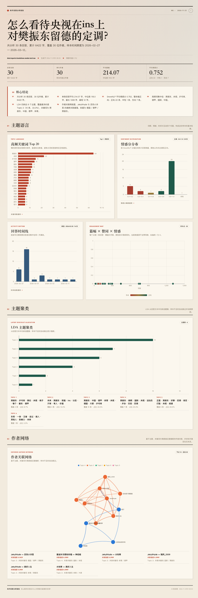

# Zhihu Answer Analysis Report Skill

A standalone repository that crawls Zhihu question answers and turns them into a Markdown analysis report with:

- `jieba` keyword segmentation and a bundled Chinese stopword list
- word cloud generation with a custom palette
- `SnowNLP` sentiment analysis with bucket distribution
- LDA topic clustering
- an inferred author association network
- an editorial-style ECharts dashboard embedded directly in `report.md`

This repo can be used in two ways:

1. As a standalone local analysis tool
2. As a Codex skill repository

## Features

- Crawl every visible answer under a Zhihu question
- Accept an answer URL and automatically expand to the parent question
- Accept pasted share text that contains a Zhihu link
- Re-analyze an existing local Markdown export or `answers.jsonl` without crawling again
- Generate a self-contained dashboard with light/dark themes, responsive layout, direct labels and data tables
- Generate:
  - `report.md`
  - `analysis/summary.json`
  - `analysis/answers.jsonl`
  - `analysis/dashboard.html`
  - `analysis/wordcloud.png`
  - `raw/entries/*/index.md`
  - `raw/zhihu.db`

## Preview

Sample dashboard render generated from the bundled report script:



## Requirements

- Python 3.10+
- A valid Zhihu login cookie for live crawling
- Optional: a Chinese font for the word cloud (macOS, Linux and Windows common paths are auto-detected)

## Installation

```bash
git clone https://github.com/Smartloe/zhihu-answer-analysis-report-skill.git
cd zhihu-answer-analysis-report-skill
python3 -m pip install -r requirements.txt
```

If pip reports `externally-managed-environment` (PEP 668), use a virtualenv:

```bash
python3 -m venv .venv
source .venv/bin/activate
python3 -m pip install -r requirements.txt
```

Installing the package itself (`python3 -m pip install -e .`) is optional: the bundled script adds the
repository root to `sys.path`, so it runs from any working directory as long as the dependencies exist.
If you previously installed the package from another directory, reinstall it from this checkout so the
editable mapping does not point at a deleted path.

## Cookie Setup

For live Zhihu crawling, copy the template and fill in real cookie values:

```bash
cp cookies.example.json cookies.json
```

At minimum, provide real `z_c0` and `d_c0` values. `z_c0` is a session token: when it expires, the API returns `403`, and you need to export a fresh cookie from a logged-in browser.

You can also place multiple accounts under `cookie_pool/` if you want rotation.

## Usage

Analyze a Zhihu question:

```bash
python3 scripts/zhihu_answer_report.py \
  "https://www.zhihu.com/question/2010761296434458950"
```

Analyze an answer URL by expanding to the full question:

```bash
python3 scripts/zhihu_answer_report.py \
  "https://www.zhihu.com/question/2010761296434458950/answer/2014338133962027157"
```

Analyze an existing local directory without crawling again:

```bash
python3 scripts/zhihu_answer_report.py ./data/reports/<bundle>/raw
```

Analyze an existing `answers.jsonl` dataset:

```bash
python3 scripts/zhihu_answer_report.py ./data/reports/<bundle>/analysis/answers.jsonl
```

Fast smoke test:

```bash
python3 scripts/zhihu_answer_report.py \
  "https://www.zhihu.com/question/2010761296434458950" \
  --answer-cap 30 \
  --no-images
```

## Useful Flags

- `--answer-cap N`: cap the number of answers
- `--output-dir PATH`: write outputs to a custom directory
- `--no-images`: skip image downloads
- `--stopwords FILE`: extend the bundled stopword list
- `--font-path FILE`: override the word cloud font
- `--top-k N`: control the top keyword count
- `--min-word-length N`: minimum token length
- `--lda-topics N`: number of LDA topics (set to 0 to disable)
- `--lda-words N`: top words per LDA topic
- `--lda-max-iter N`: LDA training iterations
- `--network-max-nodes N`: cap author nodes in the inferred author network (`0` disables it)
- `--network-max-edges N`: cap author links in the inferred author network

## Output Layout

```text
output-dir/
├── report.md
├── analysis/
│   ├── answers.jsonl
│   ├── corpus.txt
│   ├── dashboard.html
│   ├── summary.json
│   └── wordcloud.png
└── raw/
    ├── entries/
    └── zhihu.db
```

The dashboard is fully self-contained and works offline: `assets/dashboard.css`, `assets/dashboard.js` and
the pinned ECharts build (`assets/echarts.min.js`) are inlined into `analysis/dashboard.html` at generation
time. The page supports a light/dark toggle, remembers the choice in `localStorage`, and reports its height
to the Markdown iframe host through `postMessage`.

## Troubleshooting

- **`Resolving timed out` / `curl: (28)`**: curl_cffi's bundled libcurl does not read the macOS system resolver.
  The script now detects system DNS servers automatically. Override them with
  `ZHIHU_DNS_SERVERS="223.5.5.5,119.29.29.29"` or disable the fix with `ZHIHU_DISABLE_DNS_FIX=1`.
- **`403` from the Zhihu API**: the login cookie is missing or expired. Export a fresh `z_c0`.
- **LDA is skipped**: at least `max(8, topics × 2)` answers with usable text are required. Lower `--lda-topics`
  or crawl more answers.
- **Author network is skipped**: at least 3 authors and shared keywords/topics are required.
- **Word cloud font missing**: pass `--font-path` or set `ZHIHU_FONT_PATH`.

## Development

Run the smoke test suite:

```bash
python3 -m pytest tests/ -q
```

Network tests are opt-in:

```bash
RUN_NETWORK_TESTS=1 python3 -m pytest tests/ -q -m network
```

## Codex Skill Usage

The Codex skill definition is in [SKILL.md](./SKILL.md).

To install it manually into Codex, link the whole repository so the skill keeps `core/`, `scripts/`, `assets/`
and the same cookies file:

```bash
rm -rf ~/.codex/skills/zhihu-answer-analysis-report
ln -s "$(pwd)" ~/.codex/skills/zhihu-answer-analysis-report
```

Alternatively, copy the repository (excluding `.git/`, `data/` and `logs/`) if you prefer an independent copy.

After that, restart Codex and trigger it with prompts like:

```text
使用 zhihu-answer-analysis-report 技能分析这个知乎问题，并输出完整 Markdown 报告
```

## Notes

- Zhihu may report a higher answer total than the number of answers actually returned by paginated APIs.
- The report embeds the ECharts dashboard via `iframe`, so the Markdown renderer must support inline HTML for
  the chart area to appear directly in the document.
- The author network is an inferred similarity graph based on topic and keyword overlap, not Zhihu's real
  follow/comment relationship graph.
- `cookies.json`, `cookie_pool/`, `data/`, logs, and SQLite files are ignored by Git.

## License

MIT
